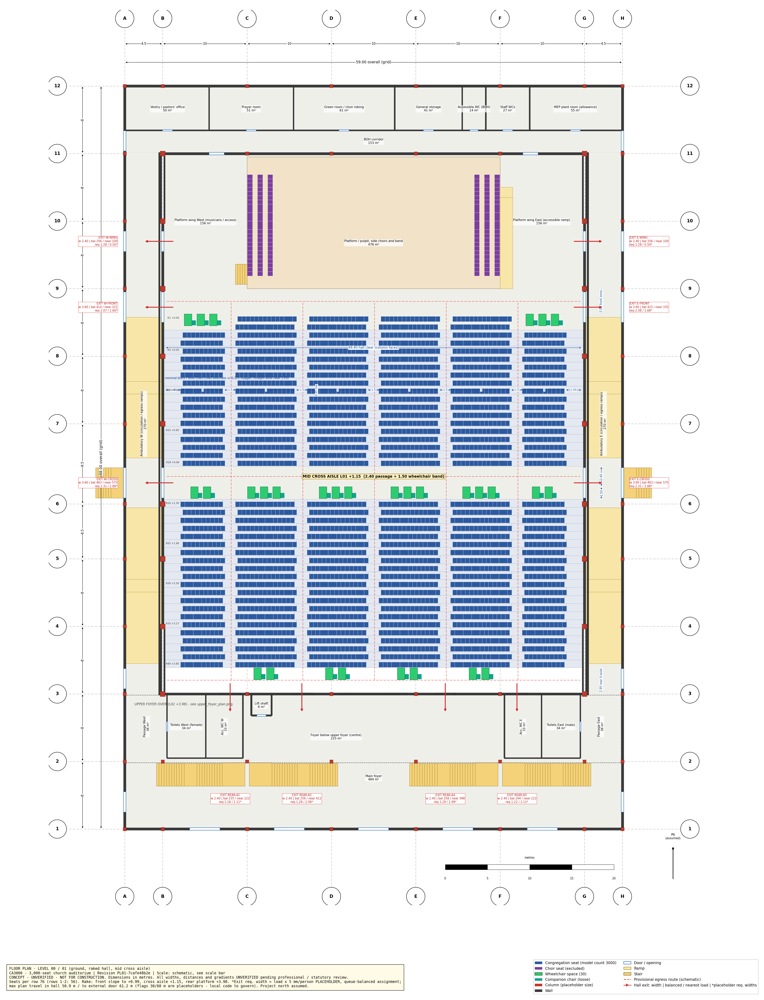
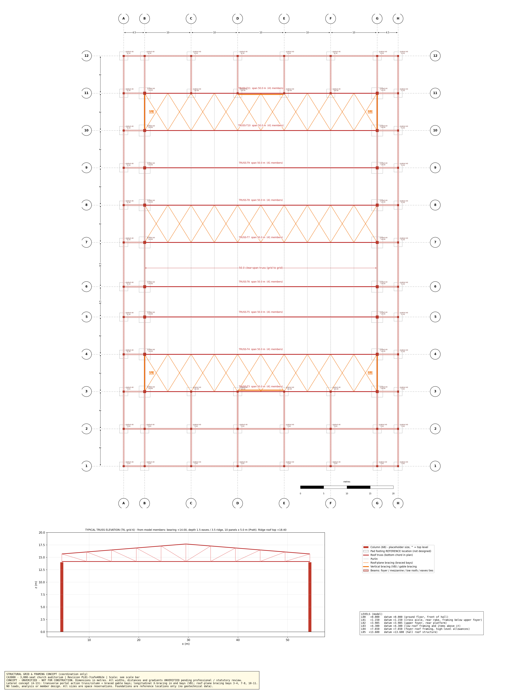
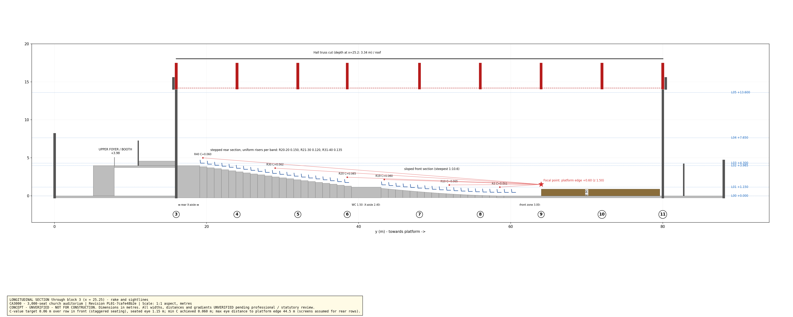

# Independent Multidisciplinary Design Critique

**Project:** 3,000-seat church auditorium, Zimbabwe (site and municipality unconfirmed)  
**Review date:** 2026-11-01  
**Reviewed revision:** `PL01-7cafe48b2e`  
**Status:** Preliminary concept review only — not structural certification, fire approval, accessibility sign-off, a construction certificate or a permit.

## Executive Verdict

The model is a disciplined and unusually traceable concept model, but the building is **not ready to proceed directly to engineering documentation or pricing as a settled scheme**. Its 3,000-seat count, basic spatial organisation, structural grid, column/footing reference coordination and longitudinal sightline recurrence are real modelled achievements. The decisive risks are elsewhere: the evacuation concept is based on placeholder factors and managed route choice; eight upper-level wheelchair places lack a resolved protected evacuation strategy; the 50 m roof, connections and foundations have not been engineered; the seating bowl contains severe horizontal viewing angles; and ventilation, acoustics, fire systems, drainage and high-level maintenance remain almost entirely unrepresented.

Three issues are design gates before the concept is frozen:

1. **Fire/egress and accessible evacuation:** nearest-exit travel reaches 39.73 m; two cross-aisle routes attract about 1,000 people each in the model's shortest-outside-route sensitivity; door operation and final safe discharge are not designed.
2. **Structural and geotechnical basis:** nine 50 m trusses and purlin bays up to 9.5 m are plausible as a form, but no loads, analysis, material grades, deflection, connections, uplift system or designed foundations exist.
3. **Bowl geometry and worship visibility:** the vertical C-value calculation passes its own assumptions, but an independent horizontal test to the modelled pulpit finds 542 seats over 45° off-axis, 184 over 60° and a maximum of 72.58°.

The provisional weighted diagnostic score is **4.7/10**. It is not a safety score; unresolved critical questions remain regardless of the total.

## Model Files, Revision and Review Methodology

### Authoritative source selection

The authoritative model is `../../model/church_3000_concept.blend`, SHA-256 `60993e41f798f68ae12a065a47039515ae73871cb2e4150707df14541971ed80`. It embeds revision `PL01-7cafe48b2e`, agrees with the current config, manifest, IFC and revision register, and incorporates the post-loop side-choir change.

The prominently named `../../renders/church_3000_concept_VIEWING_COPY.blend` is **not current**. Its SHA-256 `ea94cce77cc28e9cc56e24bbd1e26e4014dba331d8c95eef45d5ac15af9c486a` matches `model/church_3000_concept.blend1` and archived iteration 03, not PL01.

### Method

- Read source config, generator, verification, IFC validation, schedules, archived revisions and existing drawings.
- Opened the authoritative `.blend` headlessly in Blender 5.2.3 LTS without saving it.
- Independently counted/classified objects; checked world-space extents; paired columns to footing references; audited truss centreline topology; calculated seat-to-pulpit horizontal angles; checked the IFC and source reports.
- Ran separate structural/BIM, architecture/life-safety, and services/value review passes, then reconciled their conclusions.
- Copied the current-revision evidence views into this portable package and generated [`independent_model_audit.json`](EVIDENCE/independent_model_audit.json) and [`sightline_off_axis_samples.csv`](EVIDENCE/sightline_off_axis_samples.csv).

## Verified Project Metrics and Unknowns

| Item | Verified/represented value | Status |
|---|---:|---|
| Grid/building datum | 59.0 × 88.0 m grid; model extents 65.90 × 89.80 × 19.90 m including steps/footings | Verified from model |
| Units | Metric, scale 1.0, metres | Verified |
| Congregation seats | 3,000 fixed chairs in 40 rows | Verified |
| Additional places | 30 wheelchair spaces, 30 companion chairs, 144 choir chairs | Verified; statutory quantities unconfirmed |
| Seat/row module | 0.50 m seat centres; 0.95 m pitch; six blocks, 10/14/14/14/14/10 | Verified geometry |
| Interior/wall aisle clearance | 1.52 m / 1.835 m Blender-measured | Verified; legal adequacy unknown |
| Stage | 30.0 × 15.6 m, +0.90 m; 22.8 m clear centre | Verified |
| Roof | Nine trusses, 50.0 m span, bearing +14.00 m; ridge top +18.40 m | Verified geometry; not engineered |
| Frame spacing | 8/8/6.5/9.5/8/8/8/8 m | Verified |
| Structure | 68 columns, 68 pad references, 88 purlins, 72 braces, 2 gable struts | Verified counts |
| Hall exits | 10 openings, 28.8 m nominal total width | Verified openings; door sets/effective widths unknown |
| Travel diagnostics | 39.73 m nearest hall exit; 50.87 m queue-balanced hall exit; 61.17 m exterior | Verified model outputs; thresholds are placeholders |
| Site, wind, rain, soil, utilities | Not supplied | Unknown / design gate |
| Fire, MEP, acoustics, drainage | Space allowances or absent | Not assessable as systems |

## 1. Structural Engineering and Foundations

### STR-001 — Braced load paths are indicated but not demonstrably continuous

- **Category / location / affected IDs:** Lateral stability; wall bracing on B/G in bays 3–4 and 10–11; gable bracing/struts at grids 3 and 11.
- **Observed condition:** Roof-plane, wall and gable bracing are present. However, wall-brace bounds stop about 34.6 mm short of the B/G column faces and gable collector geometry leaves about 10 mm gaps to D/E posts. The transverse strategy also cites portal action, but no moment-knee connection is represented.
- **Evidence:** `STR-BRACE-WALL-*`, `STR-STRUT-GABLE-*`, `STR-COL-*`; manifest AABBs; [`07_structure_only.png`](EVIDENCE/07_structure_only.png); generator lines 1104–1137.
- **Why it matters:** The narrative load path cannot be relied on until collector, gusset and moment connections transfer wind/uplift/seismic actions to foundations.
- **Severity / confidence / status:** **High / High / Verified from model; requires specialist analysis.**
- **Recommendation / owner / timing:** Put brace nodes on declared joints or model explicit collector/gusset zones; identify moment bays; analyse the whole lateral system. Structural engineer, before engineering.

### STR-002 — The 50 m roof and 9.5 m secondary bay are unanalysed

- **Observed condition:** Nine repeated 50 m Pratt-type trusses use placeholder member sizes. Purlins bridge bays up to 9.5 m. No load basis, material grade, global analysis, buckling restraint, camber, deflection, vibration, ponding or uplift check is supplied.
- **Evidence:** A-11/A-12, OI-04; `STR-TRUSS-*`, `STR-PURLIN-*`; [`02_structural_grid.png`](EVIDENCE/02_structural_grid.png).
- **Why it matters:** Roof sheeting, drainage falls, ceilings, acoustic treatment and AV loads depend on serviceability and stability, not visual plausibility.
- **Severity / confidence / status:** **High / High / Indicated by model; requires specialist analysis.**
- **Recommendation / owner / timing:** Establish site actions and load combinations, analyse trusses/frames/purlins, and test whether the 6.5/9.5 m irregularity is economical. Structural engineer, before engineering/pricing.

### STR-003 — Footing locations are coordinated, but foundations are placeholders

- **Observed condition:** All 68 columns independently pair with 68 pad references at zero X/Y offset and zero vertical gap; this refutes the suspected missing-support geometry. Hall pads are 2.4 × 2.4 × 0.6 m and other pads 1.8 × 1.8 × 0.6 m with tops at −0.90 m. No soil data, pedestals, base plates, anchors, hold-downs, tie beams or wall foundations are represented.
- **Evidence:** [`independent_model_audit.json`](EVIDENCE/independent_model_audit.json), `STR-COL-*`, `STR-FTG-*`.
- **Why it matters:** Alignment does not establish bearing, settlement, uplift or overturning adequacy.
- **Severity / confidence / status:** **High / High / Geometry verified; design requires site data.**
- **Recommendation / owner / timing:** Commission geotechnical investigation, derive reactions, then design the foundation/anchorage/tie system. Geotechnical + structural engineers, before engineering.

### STR-004 — Structural connections and suspended-load supports are absent

- **Observed condition:** Primary truss ends sit over B/G columns and no unsupported primary roof end was found. Yet no plates, bolts, gussets, bearings, splices, base connections or IFC structural-connectivity relationships are modelled. The AV/lighting rig is only a spatial zone.
- **Evidence:** IFC audit; `SRV-02-ZONE`; truss topology in [`independent_model_audit.json`](EVIDENCE/independent_model_audit.json).
- **Why it matters:** Fabrication, erection, rigging capacity and fatigue/serviceability cannot be priced or coordinated.
- **Severity / confidence / status:** **High / High / Not represented.**
- **Recommendation / owner / timing:** Define connection philosophy, transport splices and certified rigging points before fabrication pricing. Structural engineer + AV consultant, before engineering.

## 2. Architecture, Seating and Sightlines

### ARC-001 — Horizontal sightlines are materially unresolved

- **Category / location / IDs:** Seating bowl, especially side blocks; all `SEAT-C-*`.
- **Observed condition:** The source verifies central longitudinal C-values, but not horizontal viewing. Independent world-coordinate calculation to the pulpit at (29.5, 65.6) finds 542 seats over 45°, 184 over 60°, 24 over 70°, maximum 72.58° at `SEAT-C-R03-B6-S10`.
- **Evidence:** [`sightline_off_axis_samples.csv`](EVIDENCE/sightline_off_axis_samples.csv), [`08_interior_from_rear.png`](EVIDENCE/08_interior_from_rear.png), `reports/seating_schedule.csv`.
- **Why it matters:** A seat can pass vertical C-value yet provide a poor pulpit, choir or screen view.
- **Severity / confidence / status:** **High / High / Verified geometry; usability requires specialist analysis.**
- **Recommendation / owner / timing:** Run 3D sight cones to pulpit, stage zones and screens; test fanned blocks, revised stage focus or removal/reorientation of the worst seats. Architect + theatre/AV consultant, before engineering.

### ARC-002 — Rear visibility relies on unmodelled screens

- **Observed condition:** The maximum modelled eye distance to the platform edge is 44.5 m. The basis explicitly assumes screens, but the model contains no screen objects, positions, viewing cones, support or fallback strategy.
- **Evidence:** SGT metrics; object inventory; [`08_interior_from_rear.png`](EVIDENCE/08_interior_from_rear.png).
- **Why it matters:** Screen decisions affect sightlines, truss loads, speaker/lighting placement and platform composition.
- **Severity / confidence / status:** **High / High / Not represented.**
- **Recommendation / owner / timing:** Fix screen/IMAG strategy and rigging loads with the roof concept. AV consultant + architect + structural engineer, before engineering.

### ARC-003 — Rake transitions create unresolved trip/fall conditions

- **Observed condition:** Front aisles follow the 1:10.56 sloped floor; a single 0.155 m step occurs at cross-aisle mouths; rear risers change from 0.150 m to 0.120 m to 0.135 m with 0.95 m goings. No auditorium handrails, contrasting nosings or step lighting are modelled.
- **Evidence:** GEO-01/GEO-05; [`03_long_section_sightlines.png`](EVIDENCE/03_long_section_sightlines.png); `ARC-RAKE-*`.
- **Why it matters:** Isolated and changing step rhythms are credible human-factors hazards in dimmed use.
- **Severity / confidence / status:** **High / High / Verified geometry; local acceptance unknown.**
- **Recommendation / owner / timing:** Redesign transitions for a legible walking rhythm and detail rails, edges, contrast and aisle lighting. Architect + access/fire consultant, before engineering.

### ARC-004 — Choir tiers are not accessibly or safely detailed

- **Observed condition:** 144 choir chairs occupy six side tiers at +1.20/+1.50/+1.80 m. Intermediate steps, handrails, guards and a wheelchair choir place are absent.
- **Evidence:** [`09_stage_from_congregation.png`](EVIDENCE/09_stage_from_congregation.png), [`10_stage_aerial.png`](EVIDENCE/10_stage_aerial.png), OI-18.
- **Why it matters:** The arrangement excludes some users and leaves edge/fall protection unresolved.
- **Severity / confidence / status:** **Medium / High / Verified from model.**
- **Recommendation / owner / timing:** Integrate safe tier access and an accessible choir position without compromising platform circulation. Architect + access consultant, detailed design.

## 3. Life Safety and Accessibility

### LFS-001 — Evacuation concentrates at two cross-aisle routes

- **Observed condition:** Nearest hall-exit travel is 39.73 m (330 occupants beyond the project's 30 m flag), queue-balanced travel 50.87 m, and exterior travel 61.17 m. In the shortest-outside-route sensitivity, the west/east cross exits attract 1,032/1,022 people, exceeding their 3.6 m openings under the project's own placeholder factor.
- **Evidence:** EGR-01R/EGR-03N/EGR-03/EGR-04; [`01_floor_plan_egress.png`](EVIDENCE/01_floor_plan_egress.png); [`source_exit_schedule.csv`](EVIDENCE/source_exit_schedule.csv).
- **Why it matters:** The favorable balanced result assumes managed route choice and does not establish simultaneous 3,000-person evacuation or safe final discharge.
- **Severity / confidence / status:** **Critical / High / Verified model behaviour; code compliance requires fire engineering.**
- **Recommendation / owner / timing:** Produce a code-based evacuation model including blocked exits, pre-movement, counterflow, platform/BOH occupants and outside dispersal; test vomitories/additional exits or a narrower bowl. Fire engineer + architect, before engineering.

### LFS-002 — Exit widths are symbolic openings, not designed door sets

- **Observed condition:** Ten hall openings total 28.8 m nominally, but each `IfcDoor` is a thin panel with no leaf count, swing, panic hardware, hold-open logic, rating or effective clear width.
- **Evidence:** `DR-HALL-*`, `DR-EXT-*`; generator lines 234–247; OI-15.
- **Why it matters:** Door behaviour can reduce flow and create queue/impact conflicts.
- **Severity / confidence / status:** **High / High / Verified from model.**
- **Recommendation / owner / timing:** Model coordinated door sets and recalculate effective widths and queuing. Architect + fire engineer, before engineering.

### LFS-003 — Upper-level wheelchair evacuation is unresolved

- **Observed condition:** Eight wheelchair spaces sit at +3.985 m. Their only step-free vertical connection is the lift. Eight refuge zones exist beside stair heads, but they are open zones without protected enclosure, smoke separation, communication or confirmed evacuation-lift performance.
- **Evidence:** [`04_upper_foyer_access.png`](EVIDENCE/04_upper_foyer_access.png), `ACC-REFUGE-*`, A-21/OI-16.
- **Why it matters:** Arrival accessibility does not by itself provide safe emergency egress.
- **Severity / confidence / status:** **Critical / High / Verified model condition; requires fire strategy.**
- **Recommendation / owner / timing:** Resolve protected refuges and assisted evacuation/evacuation lift, or relocate these positions to independently step-free discharge. Fire engineer + architect + access consultant, before engineering.

### LFS-004 — Mid-level accessible evacuation is indirect

- **Observed condition:** Sixteen wheelchair places at +1.15 m meet adjacent exterior stairs, not ramps. Step-free movement turns along ambulatory ramps to other grade doors and can conflict with mass egress.
- **Evidence:** `ACC-WCS-M*`, `ARC-STAIR-EXT-*`, `ARC-RAMP-AMB-*`; floor plan.
- **Why it matters:** The evacuation route is longer, shared and not separately tested.
- **Severity / confidence / status:** **High / High / Verified geometry; strategy unconfirmed.**
- **Recommendation / owner / timing:** Model disabled evacuation/counterflow and test direct exterior ramps or site grading to eliminate the step. Fire/access consultant + civil engineer, before site/design freeze.

### LFS-005 — BOH staff are omitted from the egress computation

- **Observed condition:** A-16 states 3,290 occupants, including 30 BOH staff, but geometry checks assign 3,060 hall occupants plus 200 platform/choir occupants; the configured 30 staff are not included.
- **Evidence:** `staff_boh_occupants=30`; geometry-check egress metrics.
- **Why it matters:** Whole-building evacuation results and BOH exit loads are understated.
- **Severity / confidence / status:** **Medium / High / Verified source inconsistency.**
- **Recommendation / owner / timing:** Add BOH occupants/routes and reconcile the reported total. Fire engineer + BIM author, before relying on schedules.

### LFS-006 — Accessible WCs are zoning allowances, not verified facilities

- **Observed condition:** Accessible-WC spaces are allocated, but fixtures, grab rails, transfer sides, turning space, cubicle doors and service routes are absent.
- **Evidence:** `SP-WCA-W`, `SP-WCA-E`, `BOH-05`; [`source_space_schedule.csv`](EVIDENCE/source_space_schedule.csv).
- **Why it matters:** Area alone cannot establish usability or sanitary capacity.
- **Severity / confidence / status:** **High / High / Not represented for verification.**
- **Recommendation / owner / timing:** Lay out fixtures and clearances to the confirmed local requirements. Architect + access/plumbing consultants, detailed design.

### LFS-007 — Active fire-safety systems are absent

- **Observed condition:** No exit signs, emergency lights, alarms, detection, sprinklers, extinguishers or smoke-control system are represented.
- **Evidence:** Zero keyword hits in [`independent_model_audit.json`](EVIDENCE/independent_model_audit.json); OI-10.
- **Why it matters:** A high-occupancy assembly strategy cannot be coordinated without these systems and their power/water/maintenance space.
- **Severity / confidence / status:** **High / High / Not represented; off-model work unknown.**
- **Recommendation / owner / timing:** Develop fire strategy and coordinate all active systems. Fire, electrical and hydraulic engineers, before engineering coordination.

## 4. Functional and Worship Operations

The 30 × 15.6 m platform, clear centre, back-of-house corridor, vestry, prayer room, green room, storage and plant allowance form a credible programme start. Circulation is legible at concept scale and columns stay outside the seating bowl. Operational weaknesses are the untested horizontal viewing/IMAG strategy, inaccessible choir tiers, crowd interaction at the cross aisle, and no demonstrated loading/service route for musical, AV, catering or event equipment. Weddings, funerals and conferences remain plausible but untested scenarios; a furniture/event-mode study is needed before fixing the seating floor.

## 5. Building Services and Environmental Performance

### MEP-001 — Ventilation and thermal comfort are not designed

- **Observed condition:** The model has five service zones, including a roof-plant allowance, but no air-handling plant, outside-air route, ducts, diffusers, return/extract paths, controls or thermal envelope specification. Only one window exists and it is the booth view window.
- **Evidence:** `50_SRV_*`; IFC count `IfcWindow: 1`; OI-10/OI-12.
- **Why it matters:** 3,000 occupants create major heat, moisture and fresh-air demand; the architecture cannot be frozen without plant/shaft/ceiling space.
- **Severity / confidence / status:** **High / High / Not represented.**
- **Recommendation / owner / timing:** Complete climate/occupancy load study and compare mixed-mode versus mechanical systems, including resilience and plant maintenance. Mechanical engineer + architect, before engineering.

### MEP-002 — Acoustic treatment and sound-system coverage have no reserved design

- **Observed condition:** No absorptive/diffusive treatment, acoustic ceiling/cloud, speaker arrays, delay speakers, screen or noise-control build-up is modelled. Exposed hard walls/roof/trusses dominate the interior.
- **Evidence:** Object inventory; [`08_interior_from_rear.png`](EVIDENCE/08_interior_from_rear.png); OI-09.
- **Why it matters:** Speech intelligibility, worship music and neighbour noise are central performance requirements; later treatment adds weight, cost and maintenance access.
- **Severity / confidence / status:** **High / High / Not represented; requires acoustic analysis.**
- **Recommendation / owner / timing:** Set acoustic brief, model reverberation/coverage and coordinate treatment and rigging loads with structure/MEP. Acoustic + AV consultants, before roof/interior freeze.

### MEP-003 — Roof drainage and high-level maintenance are absent

- **Observed condition:** Six roof slabs are represented, but no gutters, valleys, downpipes, overflows, sumps, roof walkway, access hatch, ladder, fall-arrest or plant service route is modelled.
- **Evidence:** Zero gutter/downpipe/drain keyword hits; [`12_roof_top_plan.png`](EVIDENCE/12_roof_top_plan.png).
- **Why it matters:** The large roof catchment and 18.4 m ridge make leakage, ponding, replacement and safe access significant lifecycle risks.
- **Severity / confidence / status:** **High / High / Not represented.**
- **Recommendation / owner / timing:** Prepare rainfall/drainage design with overflow paths and a maintainability plan; feed drainage loads/falls back into truss deflection criteria. Civil/hydraulic + architect + structural engineer, before engineering.

### MEP-004 — Electrical resilience, lighting and lightning protection are only allowances

- **Observed condition:** An electrical/data riser and rig zone are reserved, but no distribution, emergency supply, backup generation, earthing, lightning protection, house/stage/emergency lighting or maintainable access is represented.
- **Evidence:** `SRV-02`, `SRV-03`; object inventory.
- **Why it matters:** Worship/AV use and life safety require coordinated power quality, resilience and safe high-level replacement.
- **Severity / confidence / status:** **High / High / Not represented.**
- **Recommendation / owner / timing:** Develop load schedule, backup philosophy, earthing/lightning study and lighting/controls concept. Electrical + AV + fire engineers, before engineering.

## 6. Aesthetics and Architectural Identity

### AES-001 — Arrival and church identity are underdeveloped

- **Observed condition:** Five 3.6 m main openings are distributed along a 59 m low facade, but no canopy, weather lobby, glazed hierarchy, forecourt, signage or drop-off is represented. Long blank walls and the dominant shed roof produce a utilitarian rather than welcoming civic/religious presence.
- **Evidence:** [`11_exterior_aerial.png`](EVIDENCE/11_exterior_aerial.png), [`06_exterior_axonometric.png`](EVIDENCE/06_exterior_axonometric.png), `DR-EXT-MAIN-1..5`.
- **Why it matters:** Thousands need a legible, shaded and weather-protected arrival; blank envelope treatment also affects heat, maintenance and security.
- **Severity / confidence / status:** **Medium / Medium / Verified model condition; aesthetic judgment.**
- **Recommendation / owner / timing:** Low-cost: continuous light canopy, lighting, signage and contrasting bays. Higher-investment: shaded glazed foyer/portico tied to forecourt and drop-off. Architect + civil/landscape, concept development.

The exposed truss rhythm gives the interior scale and honesty, but the gable X-brace is a dominant platform backdrop. It should be intentionally integrated, screened, or relocated only after structural analysis; decorative concealment must not compromise inspection.

## 7. Constructability, Maintenance and Cost Drivers

### CST-001 — Erection and temporary stability are unresolved

- **Observed condition:** Repetition helps, but each primary truss spans 50 m; transport splices, lift weights, crane access, site assembly, erection sequence, temporary bracing and staged weatherproofing are absent.
- **Evidence:** [`07_structure_only.png`](EVIDENCE/07_structure_only.png); nine repeated truss assemblies.
- **Why it matters:** These choices can dominate safety, programme and cost in the local delivery context.
- **Severity / confidence / status:** **Medium / High / Not represented.**
- **Recommendation / owner / timing:** Commission fabricator/erector and QS study comparing segment/splice/assembly options. Structural engineer + contractor + QS, before cost-plan freeze.

### CST-002 — Routine high-level replacement has no access strategy

- **Observed condition:** The hall reaches 18.4 m and anticipates AV/lighting/HVAC at high level, but no permanent access or safe mobile-equipment route is shown.
- **Evidence:** SRV zones; roof/interior evidence.
- **Why it matters:** Lamps, speakers, detectors, filters, gutters and coatings must be inspected and replaced throughout the building life.
- **Severity / confidence / status:** **High / High / Not represented.**
- **Recommendation / owner / timing:** Produce maintainability and replacement plan, including access loads/clearances and isolation zones. Architect + MEP + structural engineer, before engineering.

Primary cost drivers are the 50 m clear span, irregular 9.5 m secondary bay, foundation uncertainty, roof/envelope area, MEP/fire/acoustic systems and external/site works. No percentage saving is claimed. The best cost control is early rationalisation, not removing safety, accessibility or acoustic provisions.

## 8. Site, Planning and Future Expansion

### SIT-001 — Site design and safe final discharge cannot be assessed

- **Observed condition:** No surveyed boundary, contours, true north, roads, parking, accessible drop-off, fire-appliance route, assembly area, drainage catchment, adjacent buildings or utilities are modelled. External steps assume flat grade.
- **Evidence:** A-01/A-02/OI-02; model inventory.
- **Why it matters:** Orientation, entrance, drainage, fire access, final discharge and the 59 × 88 m fit could all change on a real site.
- **Severity / confidence / status:** **Critical / High / Not represented; requires site data.**
- **Recommendation / owner / timing:** Do not freeze orientation or discharge until topographic/boundary/utilities survey and civil/fire-access plan exist. Surveyor + civil + architect + fire engineer, after site confirmation and before engineering.

Future expansion is not demonstrated. The perimeter frame, bracing and BOH/foyer wings occupy all sides, so an expansion direction must be selected before site acquisition and structural end-bay design.

## 9. BIM / Model Integrity

### BIM-001 — The viewing copy is obsolete

- **Observed condition:** The viewing copy is iteration 03 while the authoritative model is PL01; it retains the former choir arrangement.
- **Evidence:** hashes and embedded revisions recorded above.
- **Why it matters:** Reviewers can inspect a visually convincing but superseded design.
- **Severity / confidence / status:** **Medium / High / Verified from files.**
- **Recommendation / owner / timing:** Replace with a revisioned read-only export or mark it superseded. BIM author, immediately.

### BIM-002 — Existing validation misses structural connectivity

- **Observed condition:** Source QA reports 17 Blender passes and zero clashes, but its matrix does not test member-to-column/member-to-member connectivity and therefore misses the brace/collector gaps.
- **Evidence:** [`source_blend_verification.json`](EVIDENCE/source_blend_verification.json); STR-001.
- **Why it matters:** A clean clash result can be mistaken for a connected structural model.
- **Severity / confidence / status:** **Medium / High / Verified.**
- **Recommendation / owner / timing:** Add endpoint/support topology checks with declared tolerances. BIM + structural engineer, before next issue.

### BIM-003 — One revision-register hash is internally stale

- **Observed condition:** Current source/output hashes agree except the recorded hash for `reports/model_index.md`, which does not match the current PL01 file.
- **Evidence:** `reports/model_revision.json` versus independent SHA-256.
- **Why it matters:** Small, but it weakens the claim of an atomic issue package.
- **Severity / confidence / status:** **Low / High / Verified.**
- **Recommendation / owner / timing:** Generate the index before final hash capture or omit self-referential hashing. BIM author, next issue.

Strong BIM attributes should be preserved: metric units, deterministic regeneration, discipline collections, semantic IFC classes, unique naming, current-revision 3,000-seat verification, 68/68 column-footing coordination, IFC4 export and clear concept-status labels. This is reliable coordination geometry, not an analysis model or construction BIM.

## Cross-Discipline Conflicts

| Conflict | Disciplines | Required resolution |
|---|---|---|
| Cross-aisle exits attract the largest crowds but discharge by external steps at +1.15 m | Fire, access, civil, architecture | Grade/ramp/fire strategy together, not separately |
| Acoustic clouds, speakers, screens and rigging are assumed but roof is unanalysed | AV, acoustics, structural, electrical | Fix loads and access before truss design |
| Roof drainage depends on falls/deflection not yet calculated | Hydraulic, envelope, structural | Coordinate rainfall, gutter geometry and serviceability |
| Gable brace dominates the platform backdrop | Structural, architecture, worship/AV | Integrate visually without weakening lateral path |
| Upper wheelchair places rely on lift/refuge not protected | Fire, access, architecture, MEP | Decide evacuation concept before retaining positions |
| Arrival, final discharge and accessible entry depend on an unknown site | Civil, fire, access, planning | Obtain site and municipal basis before freeze |

## Evidence-Based Review Scores

| Domain | Weight | Score /10 | Confidence | Basis |
|---|---:|---:|---|---|
| Structural concept/foundation coordination | 20% | 6.5 | High | Coherent form and aligned pads; no analysis/connections/geotechnics |
| Life safety/accessibility readiness | 20% | 3.0 | High | Many routes represented; critical crowd and assisted-evacuation gates |
| Architecture/capacity/sightlines | 15% | 5.5 | High | Capacity/vertical views strong; horizontal viewing and transitions weak |
| Functionality/worship operations | 10% | 5.5 | Medium | Generous platform/BOH start; AV/service/event modes unresolved |
| Building services/comfort | 10% | 2.0 | High | Useful allowance zones, but no functioning system design |
| Constructability/cost consciousness | 10% | 4.5 | Medium | Repetition helps; erection, access and cost plan absent |
| Aesthetics/identity | 10% | 3.5 | Medium | Clear massing but weak arrival/blank envelope |
| BIM/model integrity | 5% | 8.0 | High | Strong traceability; stale viewing copy and topology gap |
| **Weighted overall** | **100%** | **4.7** | **Medium–High** | Diagnostic only; not a pass/fail or safety score |

## Critical Issues and Design Decision Gates

### Special-issue verification

| Initial issue to investigate | Evidence-based verdict |
|---|---|
| Continuous lateral load paths | **Partly supported:** roof/wall/gable bracing exists, but brace/collector gaps, absent portal joints and no analysis prevent confirmation of continuity. |
| Columns/foundations and unsupported roof members | **Main hypothesis refuted geometrically:** 68/68 columns and pads align and no unsupported primary truss end was found. Actual foundations and connections remain undesigned. |
| Simultaneous 3,000-person evacuation | **Concern supported:** crowd concentration, travel and door/final-discharge assumptions require fire engineering; no violation is declared. |
| Wheelchair access to auditorium and stage | **Internal-route concern partly refuted:** ground entry, ramps, lift and platform ramp exist. Mid/rear emergency egress and site arrival remain unresolved. |
| Rear/side/structurally obstructed sightlines | **Mixed:** no seating-bowl column obstruction was found and central vertical C-values pass, but horizontal angles are severe for many side seats and screens are absent. |
| Ventilation/acoustics/sanitation/service routes | **Concern supported:** zones exist, but functioning systems and fixture layouts do not. |
| Roof drainage and maintenance economy | **Concern supported:** repeated structure is positive; gutters/downpipes, access and replacement routes are absent. |
| Entrance experience | **Concern supported:** doors/foyer exist, but identity, shade, weather protection, forecourt and drop-off are unrepresented. |

1. Confirm site/municipality, governing by-laws, fire authority expectations and accessibility basis.
2. Decide whether the 50 m-wide single-level bowl remains viable after code-based evacuation and horizontal sightline studies.
3. Resolve upper/mid wheelchair evacuation and final discharge.
4. Establish site wind/rain/geotechnical basis and analyse the roof/lateral/foundation systems.
5. Freeze AV/screens/acoustic/ventilation concepts before roof and interior design.
6. Resolve roof drainage and maintainability before envelope detailing.

## Top 10 Prioritized Recommendations

See [`TOP_10_DESIGN_CHANGES.md`](TOP_10_DESIGN_CHANGES.md). The first five are: site/statutory basis; fire/accessible evacuation model; structural/geotechnical concept design; 3D sightline/AV redesign; and coordinated MEP/acoustic/fire concept.

## Required Specialist Studies / Surveys

- Boundary/topographic/utilities/levels survey and traffic/parking/fire-access assessment.
- Geotechnical investigation including bearing, settlement, groundwater and expansive/collapsible-soil risk.
- Site wind, rain, lightning and environmental exposure basis.
- Fire strategy and evacuation simulation with local authority engagement.
- Access audit covering arrival, seating, stage/choir, toilets, refuges and emergency evacuation.
- Global structural analysis, truss/purlin/frame/connection design and erection study.
- 3D sightline, IMAG/screen, theatrical/house lighting and AV coverage study.
- Room/acoustic modelling and noise-impact assessment.
- Thermal/ventilation load and mixed-mode/mechanical feasibility study.
- Water, sanitation, sewage, stormwater, fire-water, electrical load, backup-power and lightning studies.
- Quantity survey/cost plan and local fabricator/material-sourcing review.
- Roof and high-level maintainability/replacement study.

## What Is Good and Should Be Preserved

- Exactly 3,000 congregation seats are modelled, separate from wheelchair, companion and choir places.
- Six seating blocks limit the modelled run to seven seats from an aisle; columns stay outside the bowl.
- The central longitudinal C-value recurrence is transparent and reproducible.
- A ground-level accessible entry concept, ambulatory ramps, lift and 1.5 m-wide 1:12 platform ramp are represented; the hypothesis that no stage route exists is refuted.
- Every column has a corresponding aligned footing reference; no unsupported primary truss end was found.
- Repetition, semantic naming, discipline separation and deterministic regeneration are strong foundations for the next coordination model.

## Final Conclusion and Next Design Stage

Proceed only to a **targeted concept-validation stage**, not detailed design: confirm the site and statutory basis, run fire/access and sightline option studies, establish structural/geotechnical and environmental design bases, and develop coordinated MEP/acoustic/AV/fire concepts. The current geometry is valuable and should be used as the measured baseline, but its attractive completeness must not be mistaken for engineered or approvable completeness.

## Evidence and Source Register

### Model evidence

- [`EVIDENCE/`](EVIDENCE/) — portable images, schedules and audit outputs.
- [`MEASUREMENTS_AND_SOURCE_TRACE.md`](MEASUREMENTS_AND_SOURCE_TRACE.md) — extraction logic and object/source trace.
- [`FINDINGS_REGISTER.csv`](FINDINGS_REGISTER.csv) — controlled findings register.

### Regulatory/context sources

- Zimbabwe Urban Councils Act [Chapter 29:15], s.232 and Third Schedule: local councils adopt model building by-laws; public worship/assembly and fire provisions are within municipal control: https://zimlii.org/akn/zw/act/1995/24/eng@2018-01-01
- Zimbabwe Public Health Act [Chapter 15:17], s.94: enabling provisions include lighting, ventilation, sanitary conveniences and drainage: https://zimlii.org/akn/zw/act/1924/19/eng@2016-12-31
- Constitution of Zimbabwe, ss.22 and 83: State duties concerning access and participation for persons with disabilities: https://zimlii.org/akn/zw/act/2013/1/eng@2017-09-07
- National Disability Policy (2021), accessibility section: https://www.veritaszim.net/sites/veritas_d/files/National%20Disability%20Policy%20V4%28White%20Background%29.pdf
- Model Building By-laws, 1977, Chapter 11 secondary transcription used only to identify the likely code family; adoption, amendments and official current text must be confirmed with the actual municipality: https://www.zezuru.digital/library_chapters/model-building-bylaws-chapter-11-fire-protection/

No specific statutory exit width, aisle width or travel distance has been declared compliant in this review because the site, municipality, adopted edition/amendments, fire-load basis and official authority interpretation are not confirmed.
