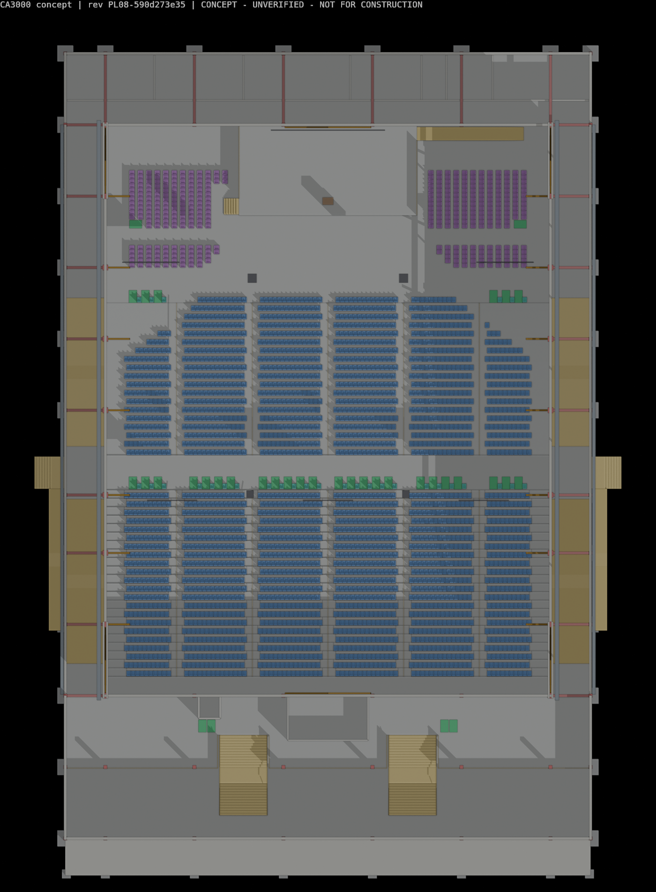
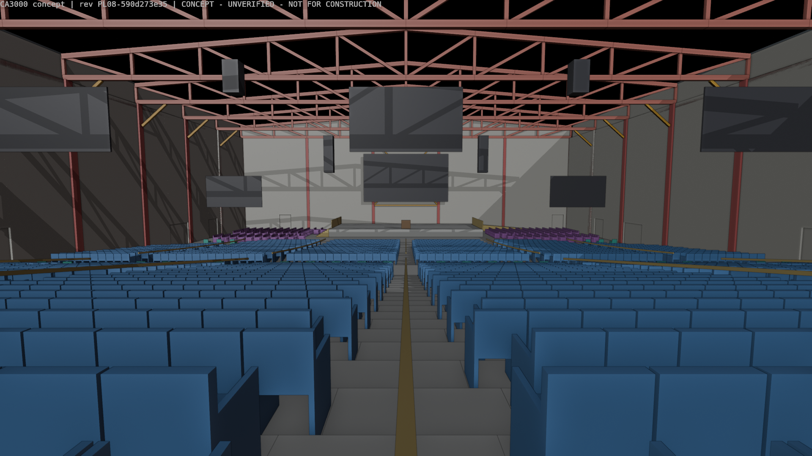

# Independent Blender MCP Design Re-review — PL06

**Authoritative model:** `model/church_3000_concept.blend`  
**Revision:** `PL06-966bde8984`  
**SHA-256:** `8fbaec2b57a68f3e0bbc70a2c226bb9ca4bce27d2cd08909c64e0c2bdb92aef9`  
**Review date:** 2026-11-02  
**Previous score (PL02):** **6.0 / 10**  
**Current score (PL06):** **6.0 / 10**

> This is a concept-design maturity score. It is not a statutory compliance determination, structural approval, fire approval or construction-readiness certificate.

## Executive verdict

PL06 contains a genuine functional redesign: the raised choir tiers have been removed, the platform has been reduced to a clear 20 m x 10 m single level, and the choir has expanded to 329 floor-level chairs in four zones around the platform. The new choir arrangement is step-free, includes two wheelchair places, keeps a measured minimum 2.551 m lateral clearance to the hall side-wall inner faces, and limits individual choir rows to 13 chairs.

Those are worthwhile worship-operation and accessibility improvements. They do not increase the overall maturity score because the change raises the modelled building population from 3,290 to 3,481 and introduces a new total-travel warning without resolving the existing evacuation, structural, services, acoustic, sightline, site and maintenance gates. The model therefore remains a **moderately coordinated concept at 6.0/10**.

## Model selection and Blender MCP methodology

`reports/model_revision.json` identifies PL06 as iteration 6. Its model hash agrees with both the independent Blender MCP read and `renders/church_3000_concept_PL06-966bde8984_VIEWING_COPY.blend`.

The authoritative `.blend` was opened through the connected Blender MCP service. The live scene was queried without saving or altering the source model. The review inspected 5,097 model objects, scene units, collection structure, IFC classifications, chair coordinates, choir section geometry, platform geometry, door properties, accessibility objects, structural support alignment, primary-truss endpoint topology, services indicators and current geometry warnings. Blender MCP reported no missing external files.

The complete MCP extraction is saved at [`EVIDENCE/mcp_scene_audit.json`](EVIDENCE/mcp_scene_audit.json).

## Verified PL06 changes

| Item | Blender MCP finding | Assessment |
|---|---|---|
| Congregation capacity | 3,000 fixed congregation chairs remain modelled. | Preserved. |
| Choir capacity | 329 chairs: 50 west-lower, 129 west-upper, 45 east-lower and 105 east-upper. | Substantial increase from PL02's 144 chairs. |
| Choir accessibility | All choir chairs are at L00; one wheelchair place is provided on each side. | Clear improvement. |
| Choir circulation geometry | Minimum chair-centre distance is 0.500 m; maximum row length is 13 chairs; minimum lateral clearance to the hall side-wall inner face is 2.551 m. | Credible concept geometry, subject to code and operational confirmation. |
| Platform | One 20 m x 10 m platform, 0.90 m high, with one east ramp and one west stair. | Simpler and more flexible than the former tiered arrangement. |
| Platform edge protection | No object classified as a platform/stage railing was found. | Exposed non-performing edges require deliberate guarding and risk assessment. |
| Occupancy | 3,481 total concept occupants, including 329 choir chairs, two choir wheelchair places and 60 platform occupants. | 191 more occupants than PL02; egress and sanitary/service demands must use the new total. |
| Door metadata | 27 fire-exit doors carry effective width, outward-opening and panic-bar assumptions. | Model coordination remains good; final fire ratings and hardware require fire-engineer confirmation. |
| Structural support geometry | 76 columns and 76 footings remain exactly aligned; nine primary trusses have no isolated non-bearing endpoints in the MCP topology check. | Geometric coordination remains strong; engineering adequacy is still unverified. |
| Model integrity | Authoritative and viewing-copy hashes match; no missing linked files were reported. | Strong. |

## Critical and major findings

### R3-LFS-01 — Evacuation route distribution remains unresolved — Critical

The project geometry report now has five warnings rather than PL02's four:

- The shortest external-route assignment still places 817 people at the west cross-aisle exit and 843 at the east. Their effective widths are 3.36 m, against project-placeholder demands of 4.085 m and 4.215 m.
- Nearest-exit in-hall travel remains 39.73 m, with 330 occupants above the project's 30 m flag.
- Queue-balanced in-hall travel improves from 52.32 m to 50.42 m, but still exceeds the placeholder.
- Maximum travel to an external door rises from 56.82 m to 61.12 m; four occupants now exceed the project's 60 m flag.
- The total modelled population is now 3,481.

The new choir layout has not caused a failure of the project's aggregate width arithmetic, and the two wing exits each have more placeholder capacity than their assigned 195 people. Nevertheless, realistic route choice, merging, crowd interaction, exit loss, external stairs/ramps, smoke conditions and final discharge remain untested. The fire strategy and evacuation analysis are still the first design gate.

### R3-ARC-01 — Choir expansion is geometrically credible but not yet performance-validated — Major

The four choir zones fit without obvious geometric overlap and maintain the stated side corridor. However, there is no dedicated choir sightline analysis to the pulpit, platform, screens or congregation; no standing-versus-seated study; no acoustic balance or monitor strategy; no furniture restraint strategy; and no operational simulation of 331 choir users joining the wing exits and backstage routes.

The lower choir blocks face almost horizontally toward the pulpit, while the upper blocks are angled inward. Because the choir sits at hall-floor level beside a 0.90 m platform, standing performers, instruments and stage equipment may obstruct views. This must be tested in 3D rather than inferred from the congregation sightline metric.

### R3-ARC-02 — Platform-edge safety is unresolved — Major

Blender MCP measured the platform from x=19.5–39.5 m and y=64–74 m, with a 0.90 m top level. No platform/stage railing object was found. The public-facing performance edge may intentionally remain open, but side and rear edges, ramp/stair transitions, choir interfaces and backstage movement require an explicit guarding strategy based on the selected code and worship operations.

### R3-STR-01 — Structural geometry is coordinated; structural design is still absent — Critical

Primary truss topology and column/footing alignment remain clean. No global analysis, loading basis, wind/seismic actions, rain/ponding assessment, connection design, foundation design, AV/acoustic rigging design, serviceability check or erection study is present. The 50 m roof remains a space-reservation concept.

### R3-MEP-01 — Services and environmental performance remain largely unmodelled — Critical

The scene contains six screens, four speaker allowances, four gutters and 28 downpipes. The MCP object audit found no ducts, diffusers, air-handling units, sprinklers, detectors, exit signs, emergency lighting, lightning protection, sanitary fixtures, roof walkways, access ladders, fall-arrest systems or access hatches. The larger choir and 3,481-person tally strengthen rather than reduce the need for ventilation, acoustic, electrical, fire, plumbing and sanitary studies.

### R3-ARC-03 — Congregation sightline risk is unchanged — Major

The congregation remains at 466 seats over 45° from the pulpit, 108 over 60°, and 2,046 seats dependent on screen assumptions. No seat exceeds 70°, which is positive, but the model still lacks verified screen occlusion, image-size, brightness, latency, redundancy and failure-mode studies.

### R3-SITE-01 — Site, discharge and arrival remain untestable — Major

The direct external ramps and entrance canopy remain useful concept features, but their success depends on the unverified flat-site assumption. There is still no survey, road network, drop-off, parking, fire access, crowd-holding area, stormwater outfall, assembly area or accessible route from a real site boundary.

### R3-BIM-01 — One material documentation inconsistency remains — Moderate

`reports/assumptions.md`, `reports/open_issues.md`, the schedules and the model correctly describe the PL06 four-zone choir and 329-chair count. However, the ARC-004 row in `reports/design_review_response.md` still describes the superseded PL04 arrangement of 144 chairs. That row should be updated so the formal response does not understate the current occupant load by 185 choir seats.

## Scorecard

| Discipline | Weight | PL06 score / 10 | Review basis |
|---|---:|---:|---|
| Structural engineering and foundations | 20% | 7.0 | Strong geometric coordination; no engineering analysis, connections, foundations or geotechnics |
| Life safety and accessibility | 20% | 5.8 | Step-free choir and established exit metadata; persistent route overload/travel warnings and a new 61.12 m total-travel warning |
| Architecture, seating and sightlines | 15% | 6.8 | Functional choir/platform redesign; congregation screen dependence and choir sightlines remain unverified |
| Functional and worship operations | 10% | 6.8 | Larger, accessible choir and clearer platform; acoustic, AV, backstage and crowd-operation studies remain absent |
| Building services and environmental performance | 10% | 3.0 | Drainage and AV allowances only; coordinated HVAC, fire, electrical, plumbing and acoustic designs absent |
| Constructability, maintenance and cost | 10% | 5.0 | Repetition remains positive; erection, high-level access, replacement strategy and cost plan absent |
| Aesthetics and architectural identity | 10% | 5.0 | Clearer platform composition; exterior and arrival remain schematic |
| BIM / model integrity | 5% | 8.8 | Strong hashes, semantics and QA; one stale formal review-response statement remains |
| **Weighted total** | **100%** | **6.0 / 10** | Functional gains are offset by increased occupant and unresolved specialist-design risk |

## Priority decision gates

1. Complete the fire strategy and evacuation model using 3,481 occupants and the actual choir route choices.
2. Resolve platform edge protection, choir aisles, loose-chair restraint, screen/performer sightlines and choir operational movement.
3. Complete global structural and geotechnical design, including all AV, acoustic, services and maintenance loads.
4. Develop coordinated HVAC, electrical/backup power, fire protection, plumbing, sanitary and acoustic designs for the revised population.
5. Complete the AV and sightline study for both congregation and choir.
6. Add surveyed site geometry and validate accessible arrival, final discharge, fire access, drainage and crowd assembly.
7. Update the ARC-004 review-response text from the superseded 144-chair PL04 layout to the 329-chair PL06 arrangement.

## What should be preserved

- Exact separation of the 3,000 congregation seats from choir, companion and wheelchair categories.
- The four-zone, floor-level choir concept and two choir wheelchair positions.
- The simpler single-level platform with an accessible ramp.
- The regular long-span frame and exact column/footing coordination.
- The reproducible model hash, disciplined naming and automated checking framework.
- The explicit concept/unverified/not-for-construction status.

## Conclusion

PL06 is better for choir accessibility and worship flexibility, but it has not resolved any of the specialist design gates that cap the project at concept level. The expanded occupancy also produces a new total-travel warning and increases services and sanitary demand. The appropriate independent score therefore remains **6.0 out of 10**.
