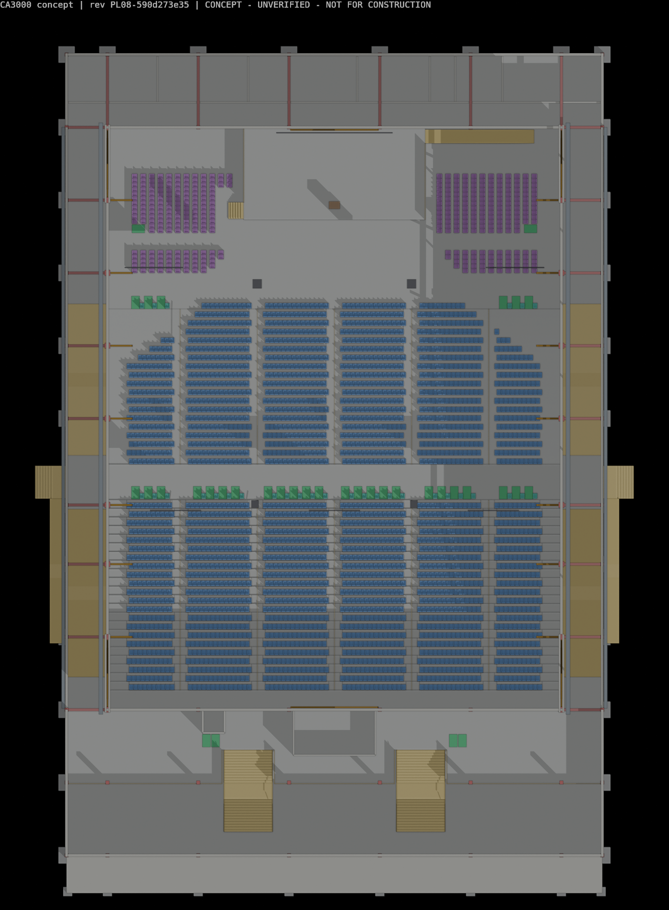
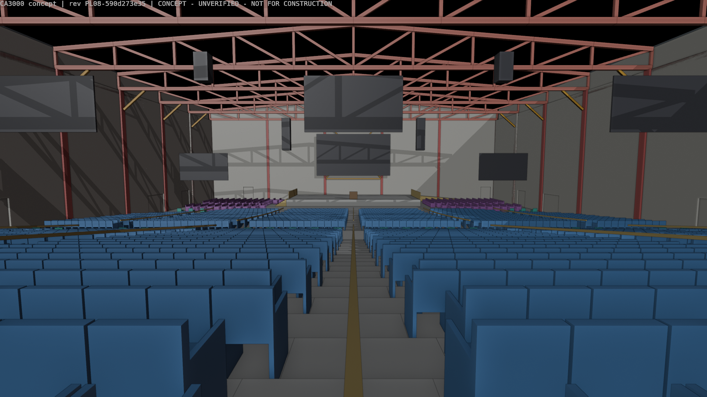
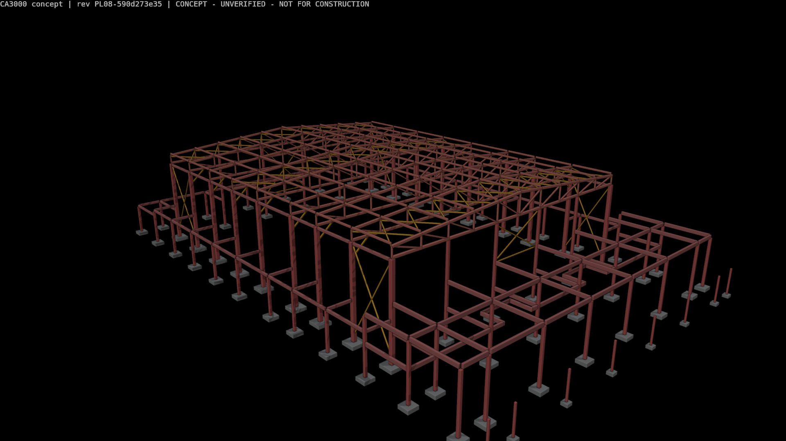

# Independent Design Re-review — PL02

**Model:** `model/church_3000_concept.blend`  
**Revision:** `PL02-18dac43917`  
**SHA-256:** `36d744a9d8aaaba11b11080b0ade2253484ad06f80fc598f7395abb57cd3db44`  
**Review date:** 2026-11-01  
**Previous independent score:** **4.7 / 10**  
**Revised independent score:** **6.0 / 10**

> This is a multidisciplinary concept-design maturity score, not a code-compliance certificate, engineering approval, or construction-readiness declaration.

## Executive verdict

PL02 is a material improvement rather than a documentation-only revision. The model now contains credible responses to several earlier findings: structural members are better connected geometrically; each modelled column has aligned support geometry; side-seat geometry is less extreme; screens and speaker allowances are present; aisle handrails and step lighting are modelled; choir and platform access are improved; upper-level wheelchair seating has been removed; direct external ramps serve the mid cross-aisle; exit doors carry effective-width, outward-opening and panic-hardware assumptions; roof drainage is represented; and an entrance canopy has been added.

The model therefore moves from a weakly coordinated concept to a **moderately coordinated concept**. It does not yet qualify as a developed design. The largest remaining risks are the unresolved evacuation distribution and travel-distance warnings, absence of structural analysis and connection/foundation design, absence of a coordinated fire/MEP/acoustic design, continuing dependence on unverified IMAG performance for many seats, missing site/discharge evidence, and missing safe high-level maintenance access.

## Review methodology

The authoritative model was selected from `reports/model_revision.json`, then checked against the current viewing copy and hash register. The `.blend` was opened headlessly in Blender 5.2.3 LTS and inspected without saving. Model-object counts, support alignment, primary-truss endpoint topology, door metadata, access objects, sightline angles, AV objects, drainage objects and absent-system indicators were extracted independently to [`EVIDENCE/pl02_readonly_audit.json`](EVIDENCE/pl02_readonly_audit.json). The generated geometry and Blender verification reports were then reviewed for residual warnings and compared with the previous findings.

The independent audit script is retained at [`EVIDENCE/pl02_readonly_audit.py`](EVIDENCE/pl02_readonly_audit.py). The earlier review remains at [`../independent_design_review/INDEPENDENT_DESIGN_CRITIQUE.md`](../independent_design_review/INDEPENDENT_DESIGN_CRITIQUE.md).

## Verified improvements

| Earlier concern | PL02 evidence | Re-review disposition |
|---|---|---|
| Structural members appeared geometrically disconnected | Nine 50 m truss assemblies each have 41 members and no isolated non-bearing endpoint in the independent topology check. Project QA also reports 352 checked structural endpoints and zero gaps. | **Geometric concern substantially resolved.** Engineering load paths, member design and connections remain open. |
| Column/support coordination | Independent audit found 76 columns and 76 footings with 0.000 m maximum plan offset and 0.000 m vertical gap. | **Model-coordination concern resolved.** These remain reference pads, not designed foundations. |
| Severe side-seat angles and no screens | Seventy-six worst-angle seats were redistributed into a 41st row. Six screens and four speaker allowances are present. Seats over 70° reduced to zero. | **Improved, not closed.** 466 seats remain over 45°, 108 over 60°, and 2,046 seats depend on screen assumptions. |
| Non-uniform rear rake, missing rails and step lights | Rows 20–41 use one 0.150 m rear riser; 10 aisle handrails and 115 step lights are present. | **Substantially resolved at concept geometry level.** Detailed guarding, nosings, photometrics and code confirmation remain. |
| Choir/platform access | Two choir step systems, four choir rails, two choir wheelchair places, and clear platform ramp/stair arrivals are present. | **Substantially resolved at concept geometry level.** |
| Exit openings lacked usable door assumptions | The model contains 45 doors; 27 are tagged fire exits with effective clear widths plus outward-opening and panic-bar assumptions. | **Improved, not fire-engineered.** Ratings, hardware, hold-open logic and final capacity criteria remain TBC. |
| Upper-level wheelchair places depended on a lift | Thirty congregation wheelchair positions are at front/mid levels; none remains on the lift-only upper level. Four upper-foyer refuge allowances remain. | **Main seating concern resolved.** Refuge protection and assisted evacuation remain open. |
| Mid-level wheelchair egress encountered external steps | Two direct external cross-aisle ramps are modelled; the steepest ambulatory route is reported at 1:13.17. | **Model concern resolved subject to actual site levels and discharge design.** |
| No roof drainage concept | Four gutters and 28 downpipes are modelled. | **Partly resolved.** Sizing, overflow, discharge, maintenance and site stormwater remain open. |
| Weak entrance emphasis | A long entrance canopy and supporting posts/pads are modelled. | **Improved, not resolved as a full arrival design.** Forecourt, weather protection performance, crowd holding and public realm are absent. |
| Stale viewing copy / weak model QA | The authoritative and viewing-copy hashes agree; 18 Blender checks pass and the current revision is labelled consistently. | **Resolved for this issue.** Some narrative registers are now stale and should be reconciled. |

## Residual critical and major findings

### R2-LFS-01 — Evacuation route distribution is still unresolved — Critical

The total exit width is generous in aggregate, but a simultaneous shortest-route assignment overloads both mid cross-aisle exits under the project's own placeholder criterion. The west cross exit receives 817 people and needs 4.085 m versus 3.36 m effective width; the east receives 843 and needs 4.215 m versus 3.36 m. The nearest-exit model also has 330 occupants beyond the 30 m placeholder and a 39.73 m maximum in-hall route. Queue balancing reduces capacity pressure but raises the maximum in-hall route to 52.32 m.

This is not proof of statutory failure because the local fire basis, measurement convention and evacuation strategy are not fixed. It is, however, a real model-derived warning that cannot be closed by total-width arithmetic. A fire engineer must test realistic route choice, exit loss, merge points, door discharge, external ramps/steps, smoke conditions and the full 3,290-person concept occupant tally.

### R2-STR-01 — Structural geometry is connected, but structural adequacy is unverified — Critical

The repeated frames, pads and bracing now form a more credible geometric system, and the earlier visible endpoint gaps have been corrected. However, there are still no dead, imposed, wind, seismic, rain/ponding, ceiling, AV, acoustic-treatment or maintenance loads; no global analysis; no stability/second-order check; no member utilisation; no serviceability/vibration assessment; no connection design; no base-plate/anchor design; and no geotechnical basis. The 50 m roof span and suspended screen/speaker allowances make these omissions consequential.

### R2-MEP-01 — Building services remain architecture-level allowances — Critical

The independent object audit found six screens, four speakers, four gutters and 28 downpipes, but no modelled ducts, diffusers, air-handling plant, sprinklers, detectors, exit signs, emergency lighting, lightning protection or sanitary fixtures. Keyword absence is not by itself proof that a system is impossible, but it agrees with the project's own open specialist requirements. There is still no demonstrated ventilation strategy, cooling load, power distribution, standby power, water/storage strategy, fire-alarm/suppression design, fixture schedule or service/plant replacement route.

### R2-ARC-01 — Sightlines improved but remain screen-dependent — Major

The worst pulpit angle reduced from 72.58° to 66.17° and no seat remains above 70°. Nevertheless, 466 seats exceed 45°, 108 exceed 60°, and the project's rule-of-thumb test classifies 2,046 seats as depending on screens for a usable view. The screens are visible in the model, but there is no verified 3D occlusion, image-size, brightness, resolution, latency, rigging, maintenance or failure-mode study. This finding is improved, not closed.

### R2-SITE-01 — External discharge, arrival and site accessibility remain untested — Major

The new direct ramps and entrance canopy are positive. Their success depends on an assumed flat site, however. There is no survey, boundary, road, parking, accessible drop-off, pedestrian segregation, fire-appliance access, crowd-holding area, stormwater outfall or final assembly point. The external stairs and ramps therefore cannot yet be proven to discharge safely or accessibly.

### R2-MNT-01 — Roof and high-level maintenance access is still absent — Major

No roof walkway, access hatch, permanent ladder, fall-arrest system or high-level replacement route was found. Gutters and downpipes create components that themselves require access. Screen, loudspeaker, roof-sheet, gutter and lighting maintenance must be designed with the structural and services concepts rather than added after the roof is fixed.

### R2-BIM-01 — The open-issues register is not fully synchronised — Moderate

`reports/open_issues.md` still says the rear riser changes at two band boundaries even though PL02 has one uniform rear band, and it does not consistently distinguish the newly modelled AV, drainage and door-hardware allowances from the specialist design that is still outstanding. The underlying specialist issues remain, but the register wording should be updated so reviewers can distinguish **modelled allowances** from **uncompleted specialist design**.

## Revised scorecard

| Discipline | Weight | Score / 10 | Basis |
|---|---:|---:|---|
| Structural engineering and foundations | 20% | 7.0 | Stronger geometric continuity and perfect column/pad coordination; no analysis, connection or geotechnical design |
| Life safety and accessibility | 20% | 6.0 | Major accessible-route and door-metadata improvements; unresolved exit distribution, travel, fire strategy, refuges and site discharge |
| Architecture, seating and sightlines | 15% | 7.0 | Exact capacity, better rake, removed worst-angle seats and added screens; substantial screen dependence remains |
| Functional and worship operations | 10% | 6.5 | Better stage/choir access and AV allowances; operational, loading, backstage and failure-mode studies remain limited |
| Building services and environmental performance | 10% | 3.0 | Drainage and AV allowances added; HVAC, electrical, plumbing, fire systems and acoustics are not designed |
| Constructability, maintenance and cost | 10% | 5.0 | Repetition and coordination are positive; erection, high-level access, replacement strategy and cost plan remain absent |
| Aesthetics and architectural identity | 10% | 5.0 | Canopy and screen composition improve the experience; exterior and arrival remain schematic and generic |
| BIM / model integrity | 5% | 8.5 | Current hash, disciplined naming and strong automated checks; narrative register inconsistency remains |
| **Weighted total** | **100%** | **6.0 / 10** | Rounded from 6.03 |

## Design decision gates before the next maturity uplift

1. Commission a fire strategy and pedestrian/evacuation analysis using the 3,290-person concept tally, realistic route choice and external discharge geometry.
2. Complete geotechnical investigation and global structural design, including AV/acoustic/MEP/maintenance loads, connections, foundations and erection sequence.
3. Fix coordinated HVAC, fire protection, power/backup, lighting, plumbing and acoustic concepts with plant and service routes.
4. Complete an AV/theatre sightline and coverage study for every seat, including occlusion, screen failure and rigging/maintenance access.
5. Add surveyed site levels, roads, parking/drop-off, accessible arrival, fire access, crowd holding, stormwater disposal and final discharge/assembly areas.
6. Reconcile `open_issues.md` and the review-response register so current geometry, remaining assumptions and specialist design gaps are stated consistently.

## What should be preserved

- The exact 3,000-seat congregation count and separate occupant categories.
- The regular nine-frame long-span concept and disciplined column/pad coordination.
- The parametric source, reproducible revision hash and automated geometry/BIM checks.
- The improved distribution of accessible seating and direct mid-level external ramps.
- The uniform rear rake, aisle handrails, step lighting and improved choir/platform access.
- The explicit use of “concept / unverified / not for construction” status markings.

## Conclusion

PL02 has addressed enough of the earlier concerns to justify increasing the score from **4.7 to 6.0 out of 10**. The next improvement will not come mainly from adding more architectural objects. It depends on turning the current allowances into coordinated specialist designs and resolving the evacuation and site-discharge warnings with authoritative criteria.
