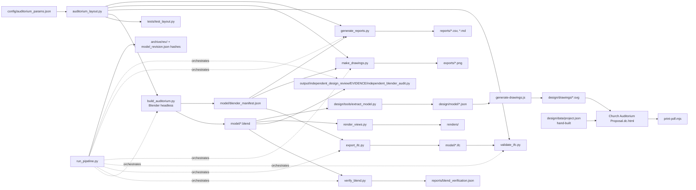

# Phase 1 audit and dependency map (2026-11-02)

Read-only audit of the project as found. Baseline: git tag `baseline-pre-restructure` (commit `5e4d604`), byte-exact
(`.gitattributes: * -text`). `BASELINE_SHA256.txt` holds 729 file hashes; `tools/verify_baseline.py` re-checks them at
their new paths (`path_map.json`).

## Findings that change the brief's assumptions

1. **The live model was PL08, not PL02.** `model/church_3000_concept.blend` carried `PL08-590d273e35`. PL03-PL08 are
   client-approved post-loop revisions (DESIGN_BRIEF.md). **Client decision 2026-11-02: Option A = PL08.**
2. **PL02 was not reproducible from the repository.** `archive/pl-02/` held outputs and config, but the nine PL02 scripts
   had been overwritten by later revisions. All ten PL02 source files were recovered from Claude Code's local file
   history by **exact SHA-256 match** with `archive/pl-02/reports/model_revision.json`; a rebuild gives a byte-identical
   manifest (`reproduce_A_pl-02.json`). The same holds for PL08 (`reproduce_A_pl-08.json`). IT01-IT03 and PL01, PL03-PL07
   remain output-only archives.
3. **The proposal pipeline (`design/`) was populated from `PL06-21c8b6d8b4`**, a revision ID that matches no archived
   build (archived PL06 is `PL06-966bde8984`). Its `data/project.json` was hand-assembled (HANDOFF.md: "build-data (to
   write)"). Kept as `designs/A-end-stage/proposal/legacy-PL06-21c8b6d8b4/`, marked superseded.
4. **Blender files are self-contained**: no linked libraries, images, fonts or sounds (checked by opening PL02 and PL08
   headless). Moving them cannot break references.
5. **Hardcoded paths**: every pipeline path is relative to `Path(__file__).parents[1]`; the only absolute path is the
   Blender default in `run_pipeline.py` (overridable by `BLENDER_EXE`). `extract_model.py` docstring names a PL06 file.
   `run_pipeline.py` deletes `renders/*VIEWING_COPY*.blend` and replaces `archive/<rev>/` for the revision it builds.
6. One render (`renders/CA3000_orbit_360_PL02-18dac43917.mp4`) was locked by VLC during the move; it was copied (hash
   verified) and the original is left untracked at the old path until it can be deleted.

## Inventory (as found)

| Area | Content |
|---|---|
| Blender models | `model/church_3000_concept.blend` (+`.blend1`), `renders/*VIEWING_COPY.blend`, `archive/*/model/*.blend` (11 revisions) |
| Generator | `scripts/auditorium_layout.py` (2,250 lines, pure-Python layout engine) -> `scripts/build_auditorium.py` (Blender) |
| Parameters | `config/auditorium_params.json` (grid, seating, sightlines, stage, foyer, structure, egress placeholders, assumptions) |
| Verification | `tests/test_layout.py` (35 tests), `scripts/verify_blend.py`, `scripts/validate_ifc.py`, regeneration hash check |
| Engineering/report scripts | `scripts/export_ifc.py`, `scripts/generate_reports.py`, `scripts/make_drawings.py`, `scripts/evaluate_review.py` |
| Rendering | `scripts/render_views.py`, `scripts/render_orbit_video.py` -> `renders/<rev>/` |
| Reports | `reports/` (schedules, assumptions, basis of design, checks, revision manifest), `FINAL_REPORT.md` |
| Reviews | `reviews/iteration-0N.json` (rubric loop), `output/independent_design_review*` (external critiques, PL01/PL02/PL06) |
| Documentation | `design/` HTML proposal template, tokens, fonts, `tools/extract_model.py`, `generate-drawings.js`, `print-pdf.mjs` |
| Agents | `.claude/agents/bim-reviewer.md`, `.codex/agents/bim-reviewer.toml` |

## Dependency map

The revision ID hashes the *contents* of the ten source files (not their paths), so moving the folder unchanged keeps
`PL08-590d273e35`. Any edit to an A script would mint a new A revision; that is why A's scripts are frozen in place and
reusable code for B is copied into `shared/` instead of being refactored out of A.
